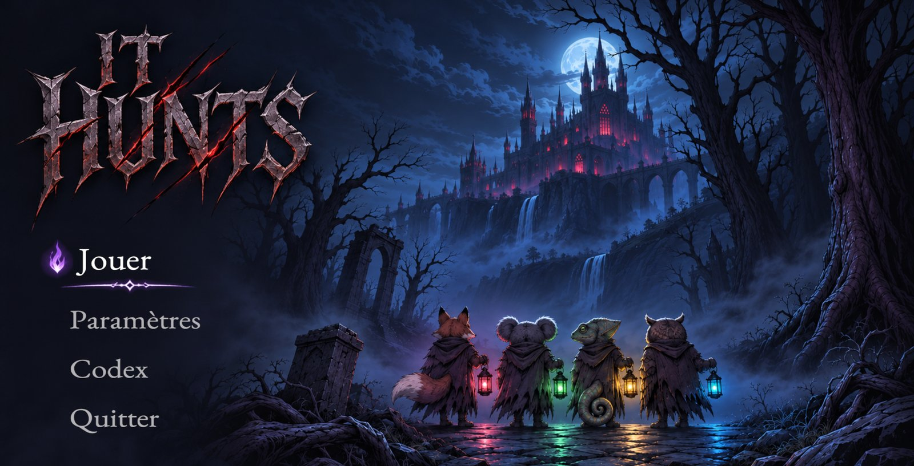
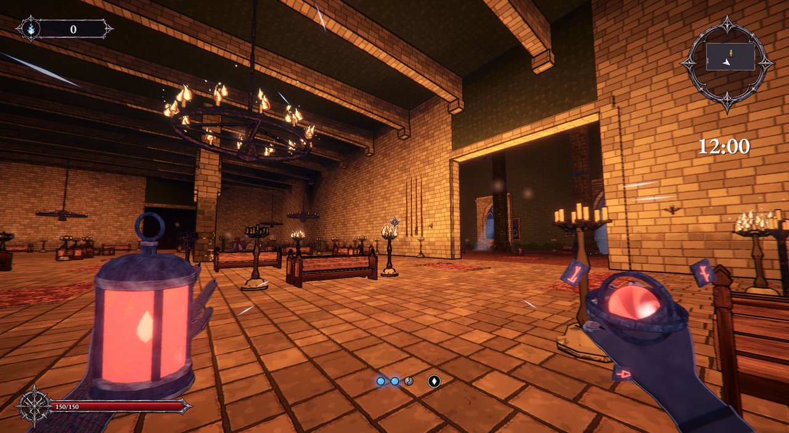
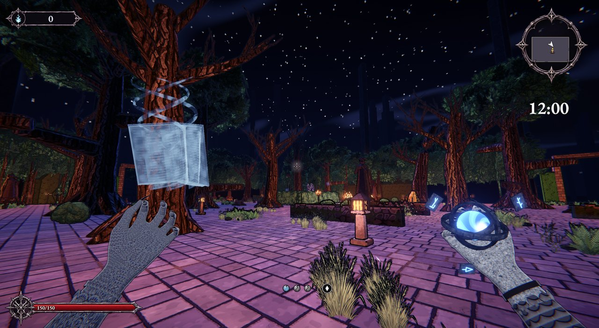

# It Hunts



| Acte II, le château | Acte III, le jardin |
|---|---|
|  |  |

Roguelite FPS de mouvement, dans des caves et un château très sombres. Une seule **orbe magique** à deux pouvoirs, utilisables en même temps : le **magnétisme** (se tracter vers un mur ou se repousser) et la **télékinésie** (attraper et lancer des objets). Pendant qu'on farme des âmes, un traqueur géant et intuable rôde. Solo et écran partagé à 2 aujourd'hui ; coop en ligne de 1 à 4 prévue.

## État actuel

Feuille de route de `CLAUDE.md` : étapes 1 à 9 faites et validées en playtest, étape 10 (direction artistique) en cours en parallèle, étapes 11 (coop en ligne) et 12 (publication) à venir.

Jouable aujourd'hui :
- une run complète : 3 actes (caves, château, jardin, deux cartes chacun) puis le boss final ;
- 4 personnages, chacun avec son artefact, et un système d'améliorations à rangs (marchand, coffres) ;
- l'écran partagé local à 2 joueurs, des menus complets et un menu de playtest avec un panneau d'administration.

## Stack

Unity 6.3 LTS (6000.3.28f1) · URP 17.3 · C# · Input System 1.20 · Cinemachine 3.1 · AI Navigation (NavMesh) · Unity Test Framework.

## Architecture

- **Contrôleur cinématique écrit à la main** : `MovementMotor.Step` est une fonction pure. Elle simule un pas fixe à partir d'une structure d'entrée (`MovementInput`), sans lire le clavier, l'horloge ni la scène. On peut donc la tester et la rejouer, ce qui prépare la prédiction réseau.
- **Machines à états explicites** : mouvement (`Ground`, `Air`, `Slide`, `WallSlide`, `Traction`, `Mantle`), orbe (`Prete`, `EnUsage`, `Recharge`), goules, volants, traqueur, boss.
- **Réglages data-driven** : environ 40 types de ScriptableObjects (mouvement, chaque pouvoir, ennemis, vagues, économie, améliorations…), réglables en Play Mode sans toucher au code.
- **Préparé pour le multijoueur** : aucun singleton joueur (tout l'état vit sur un prefab instanciable N fois), entrées par `PlayerInput` / `PlayerInputManager` (l'écran partagé fonctionne sans réécriture), état de la run séparé du joueur (`RunState`).
- **Décisions tracées** : 125 décisions numérotées (D-001 à D-125) dans `docs/design/GDD.md`.

## Comment je travaille avec l'IA

Je fais le game design et le playtest. Claude Code écrit le code, pilote Unity et Blender, et vérifie son travail.
- **Mémoire du projet** : `CLAUDE.md` (règles, piliers, feuille de route) et `docs/PROGRESS.md` (avancement, valeurs validées, points ouverts), relus au début de chaque session.
- **Skills spécialisés** (`.claude/skills/`, 29 skills : physique Unity, Input System, game feel, IA des ennemis, génération procédurale…).
- **Garde-fous** (`.claude/settings.json`) : demande avant une génération 3D payante ; interdiction des commandes destructrices (`rm -rf`, `git push --force`, `git reset --hard`, `git clean`, lecture des `.env`). Commits et pushes autorisés explicitement, prompt par prompt.
- **Deux sessions en parallèle** : une pour le gameplay, une pour la direction artistique (branche dédiée, limitée à `Assets/Art/` et `docs/art/`), fusionnées par pull request après vérification.
- **Petites étapes vérifiées** : compilation sans erreur, tests EditMode et PlayMode, un bot qui joue chaque carte, une relecture par un agent indépendant qui n'a pas écrit le code, puis **un playtest humain** qui valide le ressenti.

## Tests

- **EditMode** : 53 suites (environ 600 tests). Elles couvrent le mouvement (élan, dash, hissage, parkour), le magnétisme, la télékinésie, la parade, le combat, l'économie, les améliorations, les vagues, le traqueur, la génération des cartes et les entrées (remappage).
- **PlayMode** : 8 suites. Un bot joue chaque carte jusqu'à la sortie et bat le boss ; elles contrôlent aussi le décor, l'étanchéité des salles fermées, les portes, les offres d'amélioration, la parade en jeu et une console sans erreur.

```bash
# Avec le CLI du plugin Unity utilisé par le projet
unity command test run --mode EditMode
# Ou avec Unity en ligne de commande
Unity -batchmode -projectPath . -runTests -testPlatform EditMode -testResults results.xml
```

## Assets et licences

Chaque asset a sa ligne dans [`docs/assets/MANIFEST.md`](docs/assets/MANIFEST.md) : source, outil, usage de l'IA (oui/non, pour la déclaration Steam), licence, échelle, pivot et nombre de triangles. Les licences des outils tiers sont dans [`LICENSES/`](LICENSES/).
